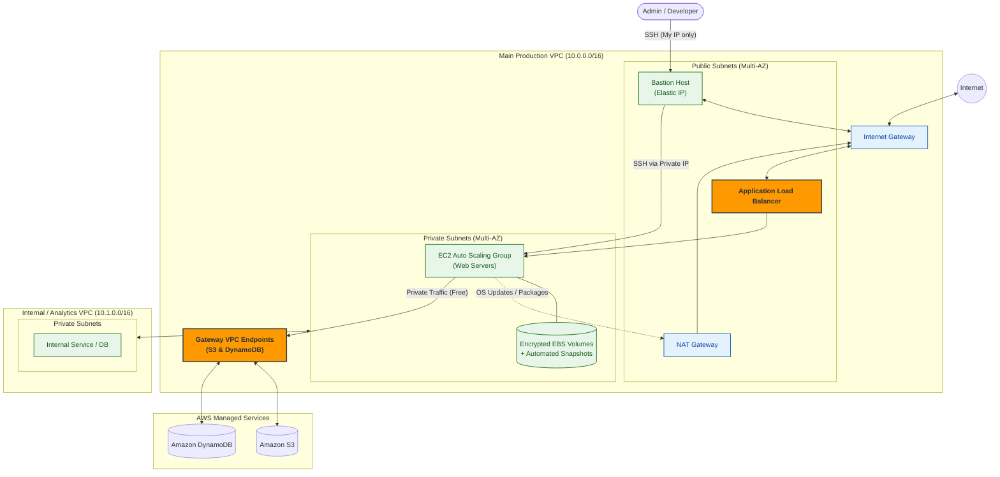

# AWS Core Networking & Compute (Terraform)

Reference Infrastructure-as-Code (IaC) project demonstrating core AWS networking, compute, storage, and security concepts using modular Terraform and automated CI checks.

## Architecture Overview



## Implemented Infrastructure Components

* **Core VPC Networking:** Custom VPC segmented into Public and Private subnets across two Availability Zones (Multi-AZ) for high availability, complete with an Internet Gateway (IGW) and NAT Gateway.
* **High Availability Compute:** An Application Load Balancer (ALB) in public subnets distributing traffic to an Auto Scaling Group (ASG) of EC2 instances isolated in private subnets.
* **Secure Administration (Bastion Host):** A hardened Bastion Host with a static **Elastic IP** in the public subnet, allowing SSH access to private instances strictly from an authorized IP address.
* **Persistent Storage & Backups:** Encrypted **EBS volumes** attached to EC2 instances with automated backup policies (Snapshots) managed via AWS Data Lifecycle Manager (DLM).
* **Private AWS Service Access:** **Gateway VPC Endpoints** for S3 and DynamoDB so private EC2 instances can access storage over the internal AWS network without paying for NAT Gateway traffic.
* **VPC Peering:** Direct private network connection between the Main Production VPC (`10.0.0.0/16`) and a secondary Internal VPC (`10.1.0.0/16`) with updated route tables.

## Repository Structure

```text
.
├── .github/workflows/   # CI pipeline (terraform fmt, validate, tflint, trivy)
├── modules/
│   ├── vpc/             # VPC, Subnets, IGW, NAT, Route Tables, VPC Endpoints
│   ├── compute/         # ALB, Security Groups, Launch Template, ASG, EBS + Snapshots
│   ├── bastion/         # Bastion EC2, Elastic IP & Security Group
│   └── peering/         # VPC Peering connection & cross-VPC routes
└── environments/
    └── dev/             # Root configuration assembling all modules
```
