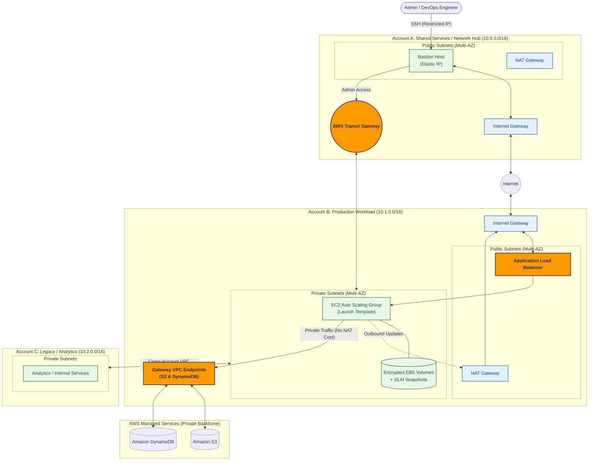

# AWS Core Networking & Compute (Terraform)

Reference Infrastructure-as-Code (IaC) repository demonstrating a multi-VPC AWS network and compute architecture built with modular Terraform and automated CI security/linting pipelines.

## Architecture Overview



## Implemented Infrastructure Components

1. **Core VPC Networking:** Multi-AZ VPCs with isolated Public and Private subnets, Internet Gateways (IGW), and NAT Gateways.
2. **Multi-AZ Compute & Load Balancing:** Application Load Balancer (ALB) distributing traffic across an EC2 Auto Scaling Group (ASG) in private subnets.
3. **Secure Bastion Access:** Bastion Host with a dedicated **Elastic IP** and strict Security Group ingress rules.
4. **Persistent Storage & Backups:** Encrypted **EBS volumes** attached to EC2 instances with automated snapshot policies via AWS Data Lifecycle Manager (DLM).
5. **Transit Gateway (Hub-and-Spoke):** Centralized routing between the Shared Services Hub VPC and Production VPC.
6. **Cross-Account VPC Peering:** Direct private peering connection between Production and Legacy/Analytics VPCs using provider aliases.
7. **VPC Endpoints:** Gateway Endpoints for **Amazon S3** and **DynamoDB** to route traffic privately and eliminate NAT Gateway data transfer costs.

## Repository Structure

```text
.
├── .github/workflows/       # GitHub Actions CI (fmt, validate, tflint, trivy)
├── modules/
│   ├── vpc/                 # VPC, Subnets, IGW, NAT, Route Tables, VPC Endpoints
│   ├── transit-gateway/     # Transit Gateway, VPC Attachments & Routing
│   ├── vpc-peering/         # Cross-account VPC Peering & Accepter
│   ├── bastion/             # Bastion EC2, Elastic IP & Security Group
│   └── compute/             # ALB, Launch Template, ASG, EBS Volumes & DLM Snapshots
└── environments/
    └── prod/                # Root configuration assembling all modules
```
